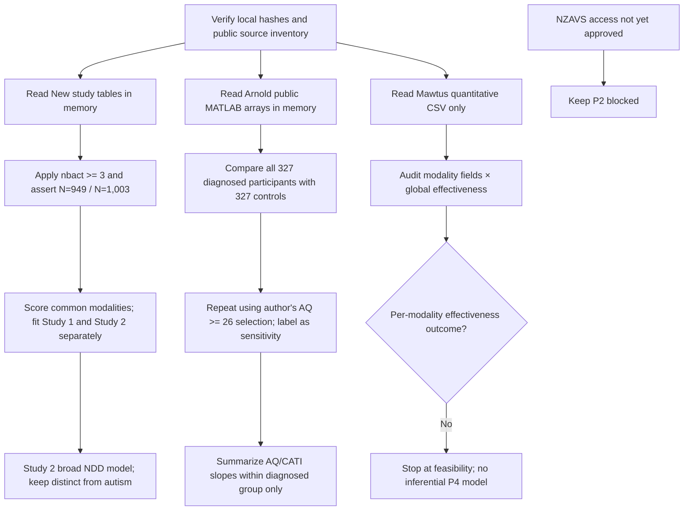

# Analysis runbook

This workspace is set up to run from the system Python and its globally installed scientific packages. It does not create or activate a virtual environment. The pipeline needs `numpy`, `pandas`, and `scipy`; the test suite also uses `statsmodels` as an independent numerical reference for the custom logistic, clustered-OLS, and repeated-modality calculations. The runtime does not require openpyxl, R, or a VM. The first-pass aggregate estimates and limitations are in [`RESULTS_SUMMARY.md`](RESULTS_SUMMARY.md); they are exploratory pending the measurement and novelty gates in the project briefs.

## One-command run

From this directory:

```sh
python3 scripts/source_checksums.py
python3 scripts/audit_sources.py
python3 -m aphantasia.cli --project all
```

The third command runs every analysis whose inputs are presently available. It refreshes these aggregate-only outputs:

| Project | Files |
|---|---|
| P1 | `runs/latest/P1/p1_estimates.csv`, `p1_diagnostics.json`, `p1_source_flow.json` |
| P3 | `runs/latest/P3/p3_estimates.csv`, `p3_diagnostics.json`, `p3_source_flow.json` |
| P4 | `runs/latest/P4/p4_feasibility.json` |
| P2 | reported as awaiting access; no inference is run |

The package is installed into the global user Python site; no environment or VM is used. From this workspace, `aphantasia --project all` is the equivalent console command. Individual runs use `--project P1`, `--project P3`, or `--project P4`; `--root` points to a directory holding the source files and `--output` changes the output directory. All `runs/` products are ignored by Git. During code edits, `python3 scripts/run_available.py --project all` runs directly from the workspace source tree.

## Flow



## P1: New et al. treatment and neurodevelopmental outcomes

The source `nbact` rule is applied before any analysis. Tests fail closed if it no longer reproduces Study 1 N=949 and Study 2 N=1,003. Primary models remain separate by study.

For each study, the model is:

```text
logit Pr(diag = 1) = intercept + β1(visual z) + β2(nonvisual composite)
                     + β3(age) + sex/gender indicators
```

`diag` is the confirmed binary response to “Are you currently receiving treatment for a neurologic or psychiatric condition?” with No/Yes choices. `diag2` is an open-response follow-up shown only after Yes and is excluded. The seven-item nonvisual composite is the mean of within-study z scores for sound, touch, motor, taste, smell, emotion, and voice, then re-standardized within study. The all-modality general-imagery composite is constructed and re-standardized the same way. The direct model uses visual and nonvisual terms; the separate general-imagery model uses the general composite. Common-imagery-shift and visual-minus-nonvisual linear contrasts come from the direct model's covariance matrix. Effects are odds ratios with 95% intervals. These models estimate associations conditional on the declared predictors; they are not causal.

The runner also emits an explicitly exploratory threshold model using the source script's visual cut points (`image == 5` and `image >= 35`) against the middle visual range. This is the threshold-versus-dose-response comparison; cut points are not tuned to the current-treatment outcome.

Prespecified checks emitted by the runner:

1. Fit the separate general-imagery mean model and report the two prespecified linear contrasts from the direct model: common imagery shift and visual-minus-nonvisual coefficient contrast.
2. Restrict to the paper's stated 18–30 age band; missing age is excluded from this sensitivity only.
3. Fit the Study 2 NDD outcome separately, using `isneurodev`, which combines diagnosed and strongly suspected NDD. Do not label this autism or formal diagnosis.
4. The ordinary logistic path uses a statsmodels-compatible White score sandwich; use Firth bias-reduced logistic regression if it separates because a rare sex/gender level has no treatment events. Diagnostics mark the estimator and its interval method.

No outcome imputation, modality-by-modality p-value fishing, or unqualified cross-study pooled treatment claim is made. The pooled interaction model is an explicit test of study-by-imagery effect modification. Study 2 has a missing age value, so its primary complete-case N is 1,002; the diagnostics state exact counts for every model.

## P3: autism and imagery

The primary source frame uses all 327 self-reported formally diagnosed participants and all 327 prior comparison participants represented in the published MATLAB analysis file. For six modalities (visual, auditory, smell, taste, touch, movement), it reports Hedges g and age/sex-adjusted mean differences. A long-format participant-clustered model then tests whether the autism-group contrast varies by modality; visual is the reference and the omnibus Wald test covers the five autism-by-modality terms. Strict absence (score 0) and the source-code low-imagery threshold (≤10) are summarized without silently harmonizing thresholds across instruments. These are single-dataset reanalyses; verify the older comparison cohort's provenance and workbook/code mapping before writing a synthesis.

The authors' script additionally selects autistic participants whose AQ score is at least 26, leaving N=242, and compares that subset with all 327 controls. The runner reports this as a separate sensitivity analysis. It never presents the two overlapping comparison sets as independent cohorts.

Within the diagnosed group only, fixed secondary models relate each of the six imagery scores to total AQ and AQ excluding the imagination subscale, with age and gender adjustment. Holm correction is applied across the six modality tests within each trait family. AQ/CATI are not available in the prior controls, so these results are not described as autism-trait differences between autistic and non-autistic participants.

The synthesis remains unpooled: one formal-diagnosis source and one distinct broad NDD analysis do not form a comparable meta-analytic set. External-study data are still needed for a cross-study autism synthesis.

## P4: Mawtus feasibility only

The runner reads the Stage 2 quantitative CSV and measures co-availability of modality scores, modality-involvement fields, and the overall treatment-effectiveness response. It does not read the interview transcripts. The current source does not provide outcome fields tied to each specific imagery modality; the published article also already compares effectiveness for imagery-based, visual vs other imagery, and CBT categories. The pipeline therefore stops after the count audit. Do not describe these survey responses as evidence that matching a person's imagery ability to a particular therapy causes better outcomes.

## P2: NZAVS

No NZAVS rows are present. The existing concept and request drafts specify the requested T13 imagery and baseline distress linked to T14 distress. Do not generate estimates until permission, a sponsor/collaboration route, and the approved linked extract exist.

## Testing

Run `python3 -m pytest`. Tests assert that New's exclusions recover published Ns, Arnold's full and AQ-restricted Ns remain distinct, aggregate outputs contain no response-level identifiers, and P4 stays gated at feasibility.
