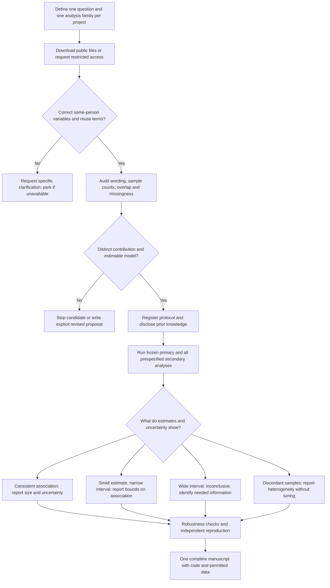

# Aphantasia research programme: execution roadmap

Prepared 11 September 2026; execution status updated 14 September 2026. This remains a staged analysis plan, not a final preregistration. Public-source audits and first-pass analyses have now run; the status below supersedes earlier statements that files had not been checked. The dataset register and analysis runbook contain exact source fingerprints and reproduction commands.

## Current execution status — 14 September 2026

| Project | Work completed | Decision now | Exact next gate |
|---|---|---|---|
| P1 — New et al. | Public OSF archive staged; `nbact >= 3` reproduces N=949 and N=1,003; questionnaire crosswalk, direct/general-imagery models, age sensitivities, and pooled study-interaction model run. | Continue as an exploratory secondary analysis. Both samples lean toward lower treatment prevalence with stronger imagery, but only Study 1 is precise; the joint interaction does not show a clear study difference. | Audit exactly what New et al. already reported and document the added value of the continuous conditional/general-imagery estimands before freezing a manuscript analysis. |
| P2 — NZAVS | Proposal and field request drafted; no NZAVS data or permission. | Await a sponsor/collaboration and approved linked extract. | Confirm T13/T14 linked-field and retention feasibility through the study's formal access route before analysis. |
| P3 — autism and imagery | Arnold UQ source files/code staged and analysed; code arrays yield N=327 diagnosed and N=327 controls, AQ≥26 selection N=242, and a participant-clustered modality interaction model. | Highest-ceiling active project, but the current output is still a one-dataset anchor. It does not support a cross-study synthesis by itself. | Verify comparison-cohort provenance and workbook-to-code mapping. The user reports already emailing the author for the separate Dance autism-study dataset; its sent date and reply status were not provided, so do not send a duplicate request. |
| P4 — Mawtus | Stage 1 and Stage 2 public archives staged; quantitative branch/linkage audit completed without opening transcript content. | Stop at feasibility: effectiveness is participant-level overall and is not linked to each therapy modality in the shared file. | Reopen only if a treatment-level linked outcome and explicit modality use/non-use can be obtained. |

P1/P3 estimates and their limits are summarized in `RESULTS_SUMMARY.md`. They are exploratory because the proposed questions were selected after publication and dataset inspection. Files from New and Mawtus contain sensitive or identifying source material; loaders keep it in memory and only write aggregate outputs. Codex has not sent messages to authors or custodians.

## Programme decision

Run access enquiries in parallel; run at most two analyses at once. Prioritize P3 acquisition/harmonization, finish P1's novelty and estimand gate, develop P2 while access is pending, and keep P4 stopped unless its data contract changes.

| ID | Proposed paper | First action | Priority and stopping rule |
|---|---|---|---|
| P1 | Visual imagery beyond nonvisual imagery: associations with reported treatment and neurodevelopmental status | Complete novelty table and freeze the direct/general-imagery estimands | Continue only if the continuous conditional analysis adds information beyond New et al.'s published categorical comparisons |
| P2 | Baseline imagery and subsequent psychological distress in NZAVS | Request a new collaboration and matched-field feasibility | Strongest longitudinal opportunity; wait for explicit access and later-wave outcomes |
| P3 | Robustness and comparability of autism–imagery associations across studies | Check Arnold cohort provenance; complete compatible-study review and data acquisition | Do not claim a synthesis until multiple independent, construct-compatible studies are verified |
| P4 | Imagery modality and perceived therapy effectiveness | Completed Mawtus linkage audit | Stopped unless treatment-level modality and outcome linkage becomes available |

These are four candidate manuscripts, not four guaranteed papers. Do not divide P1 into separate visual, auditory and NDD papers from the same analysis family. Keep NZAVS distress, wellbeing and imagery modalities together unless a later project adds a genuinely different design. The main work is establishing a defensible question and measurement, not fitting a regression.

Planning assumptions: one lead researcher spending approximately 10–15 hours/week, access to statistical review, and an academic sponsor for restricted datasets if required. These are workload estimates, not promises: P1 approximately 6–8 active weeks; P2 approximately 8–12 weeks after access; P3 approximately 10–16 active weeks plus author response delays; P4 approximately 6–8 weeks after feasibility is confirmed. A sensible initial goal is one strong submission, with another project analysis-ready, rather than four rushed submissions in three months.

## Overall flowchart

## Stage 0 — Days 1–3: establish the working setup

1. Name the lead analyst, the person responsible for correspondence and a methods reviewer. One person can cover the first two roles. If unaffiliated, use the public-data route first and seek a sponsor for restricted requests; describe affiliation honestly.
2. Maintain separate P1–P4 folders, each with `protocol`, `data_raw`, `data_derived`, `code`, `results` and `manuscript`. Raw files are immutable. Keep restricted data out of public version control; use only custodian-approved storage for restricted extracts.
3. Save a source manifest: source URL/DOI, download date, file name, version/checksum, licence, accompanying codebook and analysis scripts. A repository landing page alone does not establish that all required variables are shared.
4. Create a variable map with columns: study, original column, exact question, response labels, missing/skip codes, units, scale direction, scoring rule, harmonized column, role in model and source documentation.
5. Keep a decision log. Record every departure from this roadmap, its reason, date, whether outcomes had been examined, and its effect on the primary claim.
6. Ask the sponsor/institution to determine which review or data-use requirements apply to the planned secondary analyses. Do not claim that original ethics approval automatically covers every new use. This is an administrative dependency for restricted work, not a reason to delay reading public documentation.

Default analysis environment: R, scripted data processing and a reproducible manuscript. Use package locking and an independently reproducible run from raw data to tables. No need for machine learning infrastructure or an app.

## Stage 1 — Days 1–14: obtain data and documentation

Full editable emails are in `data-request-drafts.md`. Replace identity placeholders and attach the appropriate field list below. Those drafts are not sent messages.

| Project | Route | Essential request |
|---|---|---|
| P1 | [OSF 2bdn6](https://osf.io/2bdn6/); clarify with New et al. only if necessary | Both samples, item/scales, study identifier, exact treatment/NDD categories, exclusions, codebook and scoring scripts |
| P2 | New collaboration with Chris Sibley via [official NZAVS page](https://www.psych.auckland.ac.nz/en/about/new-zealand-attitudes-and-values-study.html) | First request field availability and retention counts; request an approved linked extract only after feasibility and governance are agreed |
| P3 | [Arnold UQ public dataset](https://doi.org/10.48610/57f325b); Taylor/King author requests; Dance/Bouyer where relevant | Item responses, diagnostic categories, recruitment/exclusion flags, exact instructions and cohort provenance |
| P4 | [OSF v7krh](https://osf.io/v7krh/); questionnaire clarification if needed | PSI-Q items, auditory-therapy use, effectiveness tied to that therapy, multiple-therapy structure and branch logic |

Every request should contain: a one-sentence question; the specific new contribution beyond the source paper; the requested fields and why each is needed; the proposed primary model; affiliation/sponsor; intended output; storage/access arrangements; and a question about overlapping unpublished work. Ask whether a formal application or collaboration is required. Data provision does not automatically settle authorship; agree substantive roles and credit transparently.

Request cadence: initial request on Day 0; one follow-up at Day 7; final follow-up at Day 14; mark dormant on Day 28 without a reply. These are proposed intervals, not scheduled automations. A refusal ends that request unless the custodian offers a revised route.

## Stage 2 — first 3–5 working days after each dataset arrives

Produce a one-page audit for each dataset before testing new associations:

1. Confirm data licence/agreement permits the intended analysis and publication outputs.
2. Count rows, unique study-specific participant IDs and duplicates. Identify repeated measurements before deciding the unit of analysis.
3. Reconcile recruitment, attention-check, exclusion and final analysis counts with the source paper. Differences are documented and resolved; never delete rows merely to force a published N.
4. Verify exact scale orientation and reverse-coded items. Use instrument/source scoring rules; if none specify incomplete-item scoring, require a complete subscale rather than inventing an 80% rule. Preserve raw responses for later imputation.
5. Distinguish unanswered items, explicit absence, not applicable, structural skips and “prefer not to say.” None is automatically a zero or a negative diagnosis.
6. Inspect univariate distributions, marginal outcome counts, missingness and questionnaire branching. Do not scan new exposure–outcome associations to select the project or model. For P1, do not explore Study 2's new associations while developing Study 1.
7. Reproduce published counts and relevant summary scoring. If reproducing an original association reveals information about the proposed hypothesis, record that exposure in the registration; the data are not outcome-naive simply because our new model has not run.
8. Produce a novelty table: published analysis / proposed analysis / actual added information. If the only change is another cutoff, covariate or p-value, revise or stop the candidate before full modelling.

Audit exit: signed variable map, sample-flow table, documented missingness, original-result reconciliation and a written proceed/revise/park decision. This decision cannot depend on whether the new association is significant.

## P1 — multisensory imagery and reported health status

### Verified basis and limits

New et al. describe two samples, 949 and 1,003 participants, with eight imagery modalities. The staged archive's source attention rule reproduces both denominators. Both tables contain the confirmed `diag` item “Are you currently receiving treatment for a neurologic or psychiatric condition?”; only Study 2 contains the diagnosed-or-strongly-suspected neurodevelopmental question. The continuous direct/general-imagery models and pooled study interactions are now run. [Original paper](https://doi.org/10.1016/j.cortex.2026.04.019); [OSF archive](https://files.osf.io/v1/resources/2bdn6/providers/osfstorage/?zip=).

### Exact field list

Essential: study ID; participant ID scoped to the study; all five QMI items for each of eight modalities or documented modality scores; current treatment response and verbatim question; age; recorded sex/gender; inclusion/exclusion flags. For the secondary analysis: original Study 2 NDD response, exact wording and any condition-specific/diagnosed-versus-suspected fields. Request education and occupation for description, not automatic adjustment.

If diagnosis and suspicion were collected together, retain a combined outcome. If condition labels are absent, do not write an autism/ADHD-specific paper. If treatment wording differs across samples, do not label a cross-sample comparison a direct replication. If only one sample contains the treatment outcome, revise to a one-sample project and downgrade the replication claim before analysis.

### Primary question and model

Question: Is visual vividness associated with current treatment status after accounting for average nonvisual vividness, age and recorded sex/gender?

1. Score all eight modalities according to the source codebook; orient them so higher means more vivid.
2. The current loader uses the documented modality score fields and z-scores each field within its own study. Define N as the equally weighted mean of the seven common nonvisual modality z-scores. Do not choose modality weights from their associations with treatment. This is an observed composite, not an assumed biological general-imagery factor.
3. Retain direct visual z-score as the visual-specific conditional predictor. Re-standardize the completed nonvisual and general-imagery composites within study so their effects are also per composite SD. Report common-imagery-shift and visual-minus-nonvisual linear contrasts from the direct model; do not refit a general-plus-deviation model as independent robustness evidence.
4. Outcome Y is the confirmed current neurological/psychiatric treatment question, yes=1 and explicit no=0. Unknown/skip is missing.
5. The current exploratory runner fits a separate direct model in each sample: `logit Pr(Y=1) = intercept + visual_z + nonvisual_z + age + recorded_sex_or_gender`. It also fits an all-modality mean model and computes two linear contrasts from the direct model: a simultaneous one-SD increase in visual and nonvisual imagery, and the visual-minus-nonvisual coefficient contrast. Age is entered in years; recorded categories are preserved. The ordinary logistic path uses a statsmodels-compatible White score sandwich; Firth bias-reduced logistic regression is the fallback for singularity/separation.
6. The pooled model adds study 2, visual-by-study, and nonvisual-by-study terms. It directly tests whether conditional associations differ between samples. The current output reports odds ratios and 95% intervals. Because this is a model selected after inspecting published data, the final estimand and interval method must be frozen before any confirmatory or manuscript-labeled primary analysis. Odds ratios should not be described as prevalence ratios.
7. The phrase “visual-specific” means conditional on this measured nonvisual composite. It does not prove specificity to a biological visual mechanism or remove all nonvisual confounding.

### Confirmation and secondary analyses

Apply identical coding, score construction and model to Study 2 regardless of Study 1 significance. The literature and current first-pass estimates have already been inspected. Any later registration must disclose that prior knowledge and be described as a transparent analysis plan, not an untouched or preregistered discovery.

Report both sample estimates and intervals side by side. Fit a combined sensitivity with study intercept and visual-by-study interaction to quantify disagreement. Do not use a nonsignificant interaction as proof of replication. Do not tune the model to make Study 2 agree.

Secondary family: the identical model for the broad Study 2 NDD outcome; the nonvisual coefficient for treatment; and a full eight-modality model with prespecified ridge shrinkage as a robustness/prediction check, not eight new confirmatory discoveries. Any tuning must occur inside training resamples, never on Study 2 outcomes. A latent-factor analysis is optional future work only after a separate measurement plan, not required to finish this paper.

### Outputs and results routes

- Table 1: both cohorts, outcome wording, marginal prevalences and missingness.
- Figure 1: modality distributions and correlation matrix, separated by study.
- Figure 2: visual odds ratios and intervals by study; nonvisual estimates labeled secondary.
- Table 2: exact model, complete-case counts, and score/age sensitivities. Add imputation only if the missing-data audit justifies and specifies it.
- Supplement: scoring, exclusions, all registered results and deviations.

Consistent estimates support an association beyond measured mean nonvisual imagery. Attenuation after adding N suggests that the unadjusted association is shared with other measured imagery dimensions; it does not prove mediation. A narrow interval near 1 constrains plausible associations. A wide interval or disagreement across samples is inconclusive/heterogeneous. Broad NDD results cannot be relabeled ADHD or autism findings.

Submission order: Consciousness and Cognition; then Collabra: Psychology if scope fits. Consider Cortex only if the completed evidence delivers a meaningful conceptual advance. Journal fit is a judgment, not an acceptance prediction.

## P2 — NZAVS longitudinal imagery and mental health

### Access and exact extract

The 2026 source uses T13 imagery for 32,784 people, including 261 reporting absent visual imagery. Its concurrent findings already cover distress and wellbeing. Later-wave imagery repetition and matched outcome counts are unconfirmed. [Source paper](https://doi.org/10.1016/j.neuropsychologia.2026.109527).

Request essential fields: anonymized stable panel ID; T13 visual and auditory imagery responses; exact wording and coding; T13 and T14 K6 items/score; wave completion/date interval; T13 age, recorded sex/gender and the team's recommended socioeconomic/deprivation measure; T14 response status for all eligible T13 respondents; applicable survey/longitudinal weights and clustering/stratum documentation. Secondary: T13/T14 PWI. Optional later extension: T12 K6/PWI, T15 outcomes and repeated imagery if collected. Ask for overall and no-imagery matched counts before the full extract.

If T14 K6 is absent, ask about the next available wave with the same measure. Freeze that wave before viewing new associations; rename the project interval accordingly. If no later comparable distress outcome exists, park the longitudinal distress project rather than substitute the already-published cross-sectional analysis. If PWI is absent, drop the wellbeing secondary endpoint. A repeated imagery exposure is not necessary for baseline-imagery prediction, but imagery-change analyses require it.

### Primary question and model

Question: Does the full T13 visual-imagery response profile provide an association with T14 distress beyond T13 distress and the prespecified covariates?

Primary outcome: T14 K6 on its documented original scale. Fit linear ANCOVA with robust or survey-design-appropriate standard errors:

`K6_T14 ~ factor(visual_T13) + K6_T13 + factor(auditory_T13) + age + age_squared + recorded_sex_or_gender + SES + elapsed_time`

Visual imagery is a seven-category exposure, avoiding an unverified linear dose-response assumption. Primary inferential test is the joint visual-imagery term; primary presentation is the adjusted K6 profile with simultaneous intervals across categories. Prespecified key secondary contrast: visual response 1 versus the combined 5–6 reference used for typical imagery in the source study, reporting a marginal adjusted mean difference. Standardize over the same target covariate population in all contrasts; use reference-category frequencies fixed from the eligible T13 sample.

If a listed covariate was not collected or cannot be provided, remove it in the data-audit amendment before testing new associations. Do not replace it with whichever variable reduces the imagery p-value. Survey-weight decisions must use the supplied documentation and the target-population estimand; do not multiply survey and retention weights without checking what each already covers.

Secondary: the same analysis for PWI, adjusting baseline PWI; a linear imagery score sensitivity; a floor/skew-appropriate outcome sensitivity; and, if approved, T15 extension. Rumination or mediation is not part of the first paper's main model. A T13–T14 association does not establish a mediation pathway or causality.

### Attrition and prediction claims

Compare eligible baseline respondents with retained respondents using T13 variables. Primary missing-data plan should be agreed with the panel team: multiple imputation including baseline predictors and outcome information, respecting design and temporal structure. Complete cases and appropriately constructed response-weighted estimates are sensitivity analyses. Include a delta sensitivity for missing follow-up K6, shifting its imputed values by −0.5, −0.25, 0, +0.25 and +0.5 baseline K6 SD, with no-imagery and other respondents allowed different shifts. These are hypothetical departures from missing-at-random, not estimated corrections.

If the paper claims useful prediction, additionally compare the baseline/covariate model with and without imagery using repeated five-fold participant-level cross-validation. Fit imputations/preprocessing inside training folds; keep the same folds across models. Report out-of-sample change in RMSE and R-squared. Statistical association alone does not establish useful prediction.

### Outputs and results routes

- Participant-flow and retention figure, including the no-imagery subgroup.
- Baseline characteristics and missingness/retention table.
- Adjusted later-distress profile across imagery levels and the prespecified contrast.
- Main estimates alongside missingness and model sensitivities.
- Separate prediction-performance panel only if that claim is made.

An association after baseline adjustment supports prospective conditional association. If it vanishes after baseline adjustment, report little evidence of an additional association beyond existing distress, with the actual interval. Neither finding establishes causation. If attrition assumptions reverse conclusions, that uncertainty becomes a central result. Sparse no-imagery retention may limit that contrast even if the full-scale analysis remains informative.

Submission order: Neuropsychologia; consider Journal of Affective Disorders only if outcome coverage and clinical relevance support its scope.

## P3 — autism–imagery synthesis

### Scope and eligibility

Question: Which autism–imagery findings remain under defensible definitions, and which comparisons cannot be harmonized?

Search PubMed, PsycINFO if accessible, and a multidisciplinary citation database available through the institution; search preprints and forward/backward citations. Use the core terms `(aphantasia OR hyperphantasia OR visual imagery OR multisensory imagery) AND (autis* OR Autism Spectrum Quotient OR Comprehensive Autistic Trait Inventory)`. Record complete database-specific queries, dates and screening decisions. Include adult human studies with same-person imagery measures and autism diagnosis/traits, including null findings. Exclude case reports from quantitative synthesis. Keep pediatric studies separate if found. Two reviewers screen and resolve disagreements; if only one reviewer is available, disclose the limitation and arrange independent verification before submission.

Seed studies, not a closed eligibility list: Taylor, Arnold, King, Dance Experiment 2, and Bouyer. New contributes only if its raw fields identify the relevant autism construct. See the source ledger below.

### Essential field/compatibility map

For each cohort: recruitment frame; recruitment dates/source; original instructions; imagery items/scales and direction; diagnosis versus self-identification; AQ/CATI items where actually administered; age and recorded sex/gender; exclusion flags; comparator provenance; known participant overlap.

Arnold contains 327 autistic respondents plus 327 comparisons; AQ/CATI are only in the autistic group. The public-code arrays have been processed. The earlier comparison cohort needs provenance checking. Taylor is a priority data request because its modified VVIQ result is central. King distinguishes diagnosis/self-identification. Dance's autism experiment is separate from its 1,285-person GS cohort; the public Dance OSF auxiliary dataset is a different imagery × sensory-sensitivity dataset and is not the requested autism experiment. The user reports having emailed the author for the latter. [Arnold](https://discovery.ucl.ac.uk/id/eprint/10230162/), [Arnold data](https://doi.org/10.48610/57f325b), [Taylor](https://www.nature.com/articles/s41598-026-38574-9), [King](https://doi.org/10.1016/j.concog.2024.103749), [Dance paper](https://eagleman.com/papers/Danceetal_2021_AphantasiaAutismSynesthesia.pdf), [public Dance auxiliary ZIP](https://files.osf.io/v1/resources/h24vm/providers/osfstorage/?zip=), [Bouyer](https://discovery.ucl.ac.uk/10205390/1/Bouyer%20et%20al%202025.pdf).

The detailed stop gate is in [`projects/P3_autism/protocol/provenance-audit.md`](projects/P3_autism/protocol/provenance-audit.md). Do not elevate the anchor to a synthesis until the earlier comparison cohort and workbook-to-code mapping are resolved.

### Prespecified analysis structure

Keep two separate analysis families; do not pool them together:

1. **Reported formal diagnosis versus explicitly non-autistic comparison:** within each study, estimate imagery score differences and prevalence contrasts for strict absence. Define strict absence as the instrument's documented complete-absence endpoint, not one universal numeric cutoff. Report source-defined low-imagery thresholds separately. Self-identified autism forms its own secondary group.
2. **Trait associations:** within each cohort, estimate imagery–AQ or imagery–CATI associations, adjusted for age and recorded sex/gender where shared. Keep autistic-only, mixed diagnosis-enriched and unselected/student samples separate because their score ranges and selection differ. Report adjusted regression slopes or partial correlations with exact construct labels.

Use item-level data to run a fixed set of within-study specifications: original score; exclusion of predefined imagination-overlap items; and published broader subscale exclusions where relevant. Specify exact item numbers from the instrument before analysis. These checks have precedent and are not alone the novelty. Compare estimates directly with correlated uncertainty; do not count how many p-values cross .05.

Pooling rule: display all eligible cohort estimates. Calculate a summary only within a construct/instrument/recruitment stratum with at least three independent comparable cohorts. This is a conservative programme rule, not a theorem. Use random-effects REML with small-sample interval adjustment and show heterogeneity uncertainty; with two, show the two estimates without a pooled headline. Unrelated standardized instruments are not automatically comparable. Prevalence using different operational definitions remains instrument-specific. No automated four-moderator meta-regression with a handful of studies. Do not infer whether wording or recruitment caused disagreement when those factors are confounded with study.

If participant data are unavailable, retain the eligible study in the review and extract its reported aggregate estimate where valid; distinguish IPD and aggregate evidence. Do not treat nonresponse to a request as a reason to erase a null study. If overlap is unresolved, do not double-count potentially shared controls in the same synthesis; use alternate inclusion sensitivities or show cohorts separately.

### Outputs and results routes

- PRISMA flowchart and data-acquisition flow.
- Construct-by-cohort compatibility matrix.
- Forest plots separated by question, instrument and sampling frame.
- Within-study definition/item-specification plot.
- Explicit ledger of non-shared data, overlap and unresolved counts.

Agreement under comparable definitions strengthens robustness. Differences that persist demonstrate unresolved heterogeneity, not its cause. If data are too incompatible, the result is a transparent measurement/synthesis limitation; assess whether that supports a useful systematic review rather than force an IPD paper. Follow PRISMA-IPD where relevant. [Guidance](https://www.prisma-statement.org/ipd).

Submission order: Autism Research if the autism contribution is substantive; Consciousness and Cognition for a measurement-focused synthesis. Resolve the final scope before selecting the journal.

## P4 — therapy capacity–modality congruence

### Hard feasibility test

Mawtus et al. report public data for 2,815 respondents, seven-modality PSI-Q and retrospective healthcare experiences. The staged audit found 2,110 answers to the overall effectiveness item, but no modality-specific effectiveness outcome. The shared therapy fields generally contain only one selected label rather than explicit yes/no use. The original study already tests broad therapy differences, so the treatment-matching model below fails its data-linkage gate and is not fitted. [Paper](https://doi.org/10.1525/collabra.127416), [Stage 2 ZIP](https://files.osf.io/v1/resources/v7krh/providers/osfstorage/?zip=), [Stage 1 ZIP](https://files.osf.io/v1/resources/uamcp/providers/osfstorage/?zip=).

Primary candidate: auditory imagery capacity × auditory imagery use in therapy. Select this conceptually before inspecting effectiveness associations. Require all of the following:

1. A retained auditory imagery score.
2. Explicit auditory-technique use or non-use, not a skipped question interpreted as no.
3. A rating of effectiveness tied to the treatment experience whose modalities are described.
4. Sufficient variation in capacity and outcome among both use groups, with overlapping observed capacity ranges.
5. A defensible row unit: one treatment per row with person ID, or one unambiguous treatment record per person.

If a person reports several therapies but one global success rating, a modality-specific effectiveness claim is not identified. Do not duplicate that global rating into several therapy rows. Park this project if clarification cannot establish the linkage.

### Primary model and interpretation

Fit `effectiveness ~ auditory_capacity * auditory_use + visual_capacity + age + recorded_sex_or_gender + treatment_type + treated_condition`, with a person random intercept if there are multiple actual treatment records. The primary parameter is the auditory-capacity × auditory-use interaction. Include both main effects. Use categories as collected and documented, not derived diagnostic certainty.

If effectiveness is binary, use logistic regression/mixed logistic regression. If it is ordered with three or more categories, use an ordinal cumulative-logit model; assess proportional odds and use a prespecified partial-proportional-odds sensitivity if necessary. Do not convert an ordinal score to a convenient yes/no outcome to obtain significance. If sparse variables make the declared model non-estimable, conduct the planned regularization/precision check, then downgrade or park; do not repeatedly delete covariates by p-value.

Display predicted effectiveness probabilities at observed 25th, 50th and 75th capacity percentiles within the overlap region, with and without auditory techniques. This is retrospective conditional association among self-selected therapy users. It is not evidence that assigning a patient to auditory therapy would help. Current imagery measured after therapy does not establish imagery capacity at the time treatment occurred.

One prespecified visual-capacity × visual-use sensitivity may be included if the same linkage requirements hold. Other modality searches are exploratory and belong in the same paper, not a new manuscript per modality.

### Outputs and results routes

- Record-linkage/branching diagram showing how responses refer to treatments.
- Capacity distributions and outcome counts in the use/non-use groups.
- Primary interaction estimate and predicted-probability plot.
- Treatment-selection, timing and missing-data limitations.

A compatible interaction motivates a prospective study; it does not justify treatment recommendations. A broad interval is inconclusive. A null-looking interaction with inadequate overlap is uninterpretable, not evidence against matching. If the fields fail the linkage test, retain only the feasibility report and move effort to P1–P3.

Submission order: Cognitive Therapy and Research or Collabra: Psychology. Behaviour Research and Therapy would need a particularly strong contribution and design; it is not a default expectation for this retrospective dataset.

## Common analysis rules — freeze before testing new hypotheses

### Precision, complexity and small effects

Run a design simulation after the audit using observed marginal counts, exposure covariance and missingness but no newly inspected exposure–outcome coefficient. Use 1,000 simulations at null and a range of associations: binary-outcome ratios 1.0, 1.25, 1.5 and their reciprocals; continuous-outcome shifts 0, 0.1, 0.2 SD. For interactions, simulate changes in slopes of comparable magnitudes. These are planning scenarios, not established meaningful-effect thresholds. Record convergence, interval width, coverage and sensitivity to collinearity.

No universal events-per-variable cutoff is a publication rule. No project proceeds solely because p<.05. Do not claim a practically null association unless a justified smallest effect of interest is set before testing and an equivalence procedure supports it. Without such justification, report the numerical interval and which effects remain compatible. Small effects may be meaningful and imprecise ones cannot be wished away with a larger model.

### Missing data

Separate structural absence of a variable from item nonresponse. Never impute NDD into New Study 1, AQ into Arnold controls as if it had been administered, or treatment outcomes for therapies never received. Use multiple imputation for plausibly missing-at-random item/covariate data with at least 50 imputations; include the model's outcome, predictors, auxiliary variables and compatible interaction structure. Impute independent cohorts separately. Check convergence, distributions and Monte Carlo stability; increase imputations if pooled estimates are unstable. Complete-case estimates are a sensitivity. Document assumptions and non-random-missingness limitations; a low missing percentage does not make complete cases automatically unbiased.

### Registration, multiplicity and amendments

Register after schema and scoring checks, before testing new associations. Disclose all prior literature results and dataset inspection. For P1 register both-sample model and Study 2 access boundaries; for the review register search and eligibility before screening. Keep one declared primary test/parameter per project and list the limited secondary family. Use Holm adjustment for secondary inferential claims within that declared family; exploratory analyses remain labeled and are fully reported. Sensitivity analyses assess robustness, not a contest to select the smallest p-value. All registered results are reported even if the primary result is null. [COS guidance](https://www.cos.io/initiatives/prereg).

### Independent verification

A second person checks scale direction, exclusions, the first primary-model output and final claim wording. They rerun the analysis from the raw inputs with only the README. Confirm every table's N and every abstract number against generated outputs. Neither manual spreadsheet edits nor hand-copied results should determine the final tables.

## Results-to-manuscript decision table

| Observed result | Required action | Claim boundary |
|---|---|---|
| Similar associations in both valid samples | Report both effects and intervals; include frozen sensitivities | Consistent conditional association; no causal assertion |
| Association appears only before adjustment | Show unadjusted and adjusted estimates, with uncertainty | Shared measured variation; not proof of mediation |
| Estimate near null, interval narrow | Report exact excluded/compatible magnitudes | “Small within these bounds”; equivalence only if properly specified |
| Interval includes large effects and null | Complete report; quantify what remains unresolved | Inconclusive, even if a point estimate looks attractive |
| Samples differ | Show discordance and compatibility limits; check prespecified coding audits | Heterogeneity; no selective pooling or model tuning |
| Structural mismatch or no overlap | Do not estimate the intended effect; write feasibility failure | Dataset cannot answer this question |

## Submission package and calendar

For each completed paper: title/abstract matching the actual estimand; introduction establishing the precise gap; full methods and sample flow; generated results tables/figures; all prespecified analyses; limitations covering measurement/selection/missingness; data-access statement; code repository and environment lock; registration link/deviations; reporting checklist; cover letter explaining the contribution. Share restricted data only as the agreement permits. Use STROBE for observational reporting and PRISMA-IPD for the synthesis where applicable. [STROBE checklists](https://www.strobe-statement.org/checklists/).

| Relative time | Work | Exit deliverable |
|---|---|---|
| Days 1–3 | Setup; public downloads; draft and send approved requests | Request tracker; three public-file manifests; P2 proposal |
| Days 4–10 | P1 schema/novelty audit; P4 linkage check; Arnold provenance check | Proceed/revise/park sheet for each |
| Weeks 2–3 | P1 precision check and registration; register P3 review protocol and screen | Frozen P1 plan; review eligibility log |
| Weeks 3–5 | P1 analysis and independent-sample confirmation; author follow-ups | Reproducible tables and complete result inventory |
| Weeks 5–8 | P1 writeup and reviewer reproduction; prepare next ready project | First submission-ready manuscript |
| Weeks 6–12 | P3 acquisition/harmonization; P2 approval/extract audit if granted | Second dataset/model ready; no forced access deadline |
| After each access approval | Start that project's audit-to-analysis sequence | Completed feasibility and preregistration before new tests |

This calendar schedules work, not guaranteed results or author responses. For the current state, complete P1's novelty/estimand gate, advance P3 when independent compatible data arrive or can be accessed, and keep P2 pending formal access. P4 is stopped unless its linkage design changes.

## Reserve leads

UK Biobank and Generation Scotland remain access-verification leads, not active analysis commitments. Ask for imagery field IDs, release status and matched counts before designing an ADHD/health/genetic study. Do not use total cohort size as the imagery-analysis N. The earlier VVIQ measurement project likewise needs its own item-level availability and novelty audit; it is not implicitly included as a fifth ready paper in this roadmap. See the separate association-project shortlist for sources and prior-access findings.
